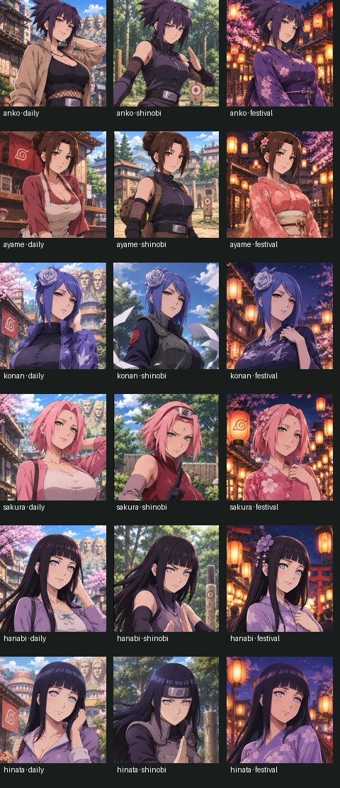
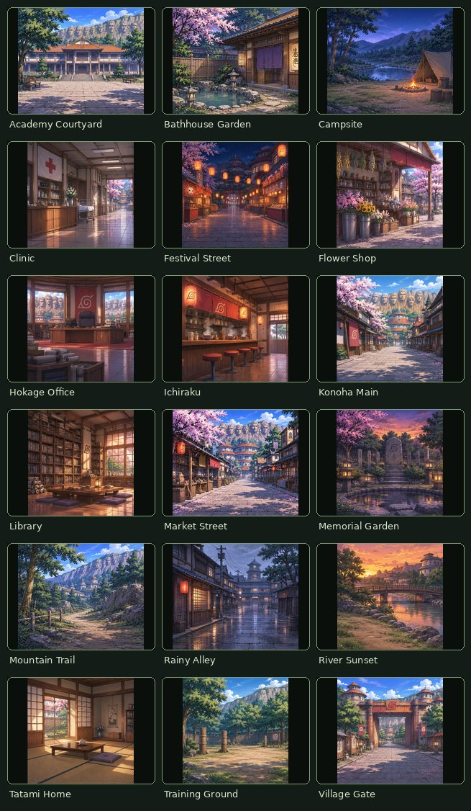
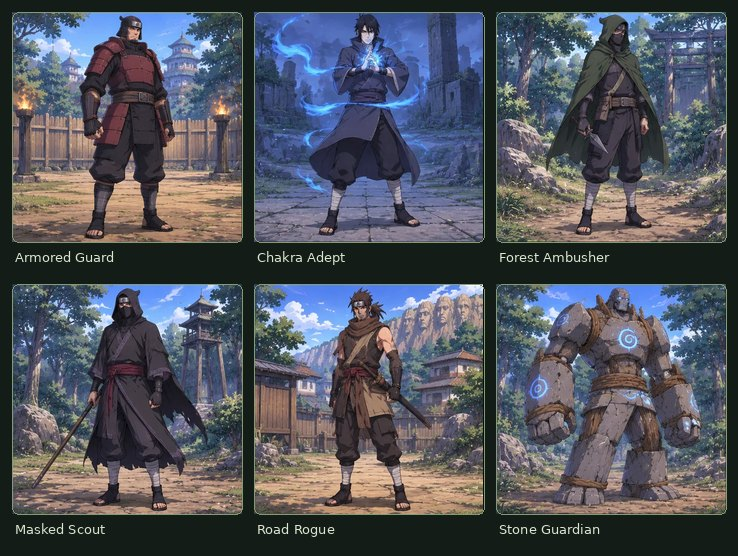

# Naruto Enot Garem — Коноха зовёт

Фанатская мобильная социальная визуальная новелла в мире Конохи. Проект сделан как обычный статический сайт: без npm-зависимостей, сервера приложений и API-ключей. В комплект входит автономный `standalone.js`, поэтому точка входа работает и при открытии `index.html` напрямую.

## Запуск

**Локально:** можно открыть `index.html` двойным щелчком. Для надёжного локального HTTP-запуска также приложен `start-local.bat`. Либо запусти в папке проекта:

```bash
python -m http.server 8000
```

Затем открой `http://localhost:8000`.

**GitHub Pages:**

1. Загрузи содержимое папки проекта в корень репозитория.
2. Открой `Settings → Pages`.
3. В `Build and deployment` выбери `Deploy from a branch`.
4. Выбери ветку `main` и папку `/ (root)`, затем сохрани.

Точка входа — `index.html`, runtime — `standalone.js`. Переходы между экранами происходят внутри одной страницы. Все пути относительные, поэтому сайт подходит для GitHub Pages и открытия с диска. Исходники остаются разложены по модулям в `src/`; после их изменения пересобери runtime командой `node scripts/build-standalone.mjs`.

## Что уже есть

- Главное меню, номер версии и создание персонажа.
- 10 вариантов происхождения, имя, манера поведения, одежда и отличительная черта.
- 28 персонажей, разные характеры и интересы; Хаку открывается как секретная встреча на зимней лесной тропе.
- Галерея из трёх образов для каждого персонажа: повседневный, тренировочный и фестивальный. Арты хранятся локально, без внешнего хостинга.
- Карта из 17 мест Конохи с перемещением без загрузочных экранов и изображениями-миниатюрами для каждой точки.
- Ускоренное время, пропуск часов, сон, погода и смена сезонов.
- Локальный игровой мастер для свободного текста: распознаёт намерения, подбирает ответы под характер, погоду, место, настроение беседы и историю встреч.
- Память о встречах, диалоговый журнал и уровни дружбы, доверия и уважения.
- Бытовые планы: готовка, уборка, покупки, учёба, тренировка, сад, помощь в больнице и отдых. Можно назначить занятие себе или другому персонажу.
- Свиток необязательных заданий, событий и собственных обещаний. Записи можно выполнять, откладывать или отменять.
- Инвентарь, подарки, еда и гардероб. Одежда влияет на небольшие реплики и реакции на погоду.
- Патрульные столкновения с шестью типами противников: обычная атака, техника чакры, защита и отступление; без графических сцен.
- Настройки размера текста, контраста и анимации, автосохранение, экспорт и импорт сохранения.

## Игровой мастер без API

Игровой мастер находится в `src/core/gm.js` и работает полностью в браузере. Это локальный сценарный движок на правилах и контекстных шаблонах, а не большая облачная языковая модель. Он не отправляет сообщения на сервер и не требует ключа. Его качество можно расширять новыми намерениями, ответами, характерами и правилами в этом модуле.

Сохранение хранится в `localStorage` браузера. Для переноса прогресса между браузерами используй экспорт/импорт JSON в настройках.

## Архитектура

```text
index.html
assets/
  css/style.css       — адаптивный интерфейс
  characters/         — по три локальных арта на персонажа
  backgrounds/        — 18 фонов Конохи и окрестностей (WebP)
  enemies/            — 6 иллюстраций противников (WebP)
  ui/                 — SVG-иконки предметов и навигации; cropped/ — PNG-спрайты интерфейса
  scene-manifest.json — карта путей фонов и противников
  leaf.svg            — значок проекта
standalone.js         — автономный runtime для index.html
scripts/
  build-standalone.mjs — сборка автономного runtime из модулей src/
  generate_art.py     — генерация векторных портретов cast
  slice_art_assets.py — нарезка контакт-листов в отдельные WebP-ресурсы
start-local.bat       — запуск локального сервера в Windows
src/
  main.js             — запуск приложения и обработчики событий
  core/
    gm.js             — локальный игровой мастер и память диалогов
    life.js           — время, погода, сезоны, активности и расписание
    store.js          — состояние, связи, инвентарь и сохранение
  data/
    characters.js     — персонажи и их характеры
    world.js          — происхождения, карта, сезоны, погода и фоны
    enemies.js        — характеристики противников и награды
  ui/
    render.js         — отображение экранов и интерфейсных компонентов
tests/
  smoke.mjs           — тест игровых систем и локальных изображений
  standalone-smoke.mjs — тест кнопки старта и автономного runtime
```

## Проверка проекта

Проверка синтаксиса модулей и автоматический smoke-тест запускаются командами:

```bash
node --check src/main.js
node --check standalone.js
node --check src/core/gm.js
node --check src/core/life.js
node --check src/core/store.js
node --check src/ui/render.js
node --experimental-default-type=module tests/smoke.mjs
node tests/standalone-smoke.mjs
```

Smoke-тесты проверяют создание состояния, данные персонажей и локаций, наличие всех изображений, перемещения, время, локальные диалоги и память, подарки, необязательные задания, бытовое расписание, смену сезона и отображение вкладок. Отдельная проверка запускает автономный runtime в тестовой DOM-среде и проходит путь «Новая история» → создание персонажа → старт → патруль → тактический бой → закрытие встречи → локальное сохранение.

## Интерфейс v0.6.0

Визуальная тема приведена к макету тёмной новеллы: сливово-фиолетовые панели, розовые акценты, светлые границы и карточки с полупрозрачными градиентами. Изображение-макет не вставляется в приложение целиком: из него вырезаны только отдельные декоративные символы без персонажей и текста, каждый хранится отдельным PNG в `assets/ui/cropped/`. Иконки реально подключены к верхней панели (время, погода, рё, настройки), нижней навигации, быстрым действиям, профилю, свитку, гардеробу и инвентарю. `ui-atlas-preview.jpg` показывает полный набор вырезанных элементов.

## Внешние ресурсы

- Для Анко, Аяме, Конан, Сакуры, Ханаби и Хинаты добавлены детализированные триптихи, нарезанные на три самостоятельных WebP-файла. Для остальных персонажей пока используются оригинальные локальные SVG-портреты в тех же трёх слотах; их можно заменить файлами PNG/WebP с теми же именами `daily`, `shinobi`, `festival`. Все образы повседневные, тренировочные или праздничные.
- В ZIP включены 18 самостоятельных WebP-фонов, 6 WebP-иллюстраций противников и 10 SVG-иконок. Фоны локальные: внешняя загрузка фоновой панорамы больше не нужна.
- Музыкальная композиция: [Japanese-style ambient — cornist, Pixabay](https://pixabay.com/music/ambient-japanese-style-ambient-475587/). Страница Pixabay открывается из меню и настроек; сам MP3 намеренно не скопирован в архив, поэтому игра не раздаёт чужой аудиофайл. Проверь условия Pixabay Content License на момент публикации.
- Шрифты подключаются из Google Fonts с системными запасными вариантами.

## Примечание

Это неофициальный фанатский проект, не связанный с правообладателями Naruto. Названия и персонажи принадлежат их соответствующим правообладателям. Код интерфейса и игровых систем можно изменять и расширять. Внутриигровые отношения представлены как дружба, доверие и союзничество; откровенных сцен нет.

## Иллюстрации и ресурсы v0.6.0

В `assets/characters/` лежит галерея из трёх образов для всех 28 персонажей (84 файла). Шесть персонажей получили детализированные WebP-портреты в трёх ситуациях; остальные используют стилизованные SVG-иллюстрации в том же формате галереи.

`assets/backgrounds/` содержит 18 фоновых сцен. Большой фон на экране мира меняется по локации, ночному времени и дождю; карта показывает миниатюры мест. `assets/enemies/` содержит шесть рисунков для патрульных столкновений, а `assets/ui/` — SVG-иконки предметов и 17 вырезанных прозрачных PNG-символов для интерфейса (эмблема, погода, валюта, настройки, чат, подарок, отношения, одежда, сон и другие).

### Предпросмотр ресурсов

**Детализированные портреты:**



**Фоны локаций:**



**Противники для патруля:**


